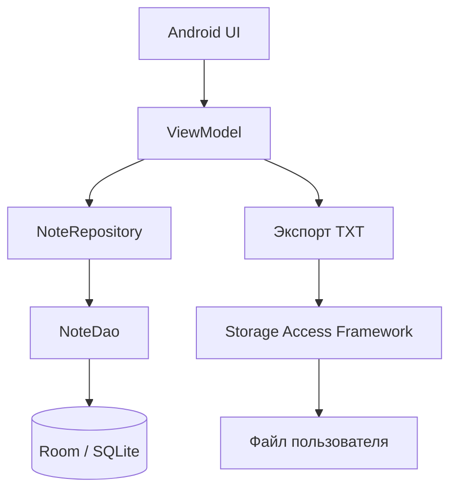
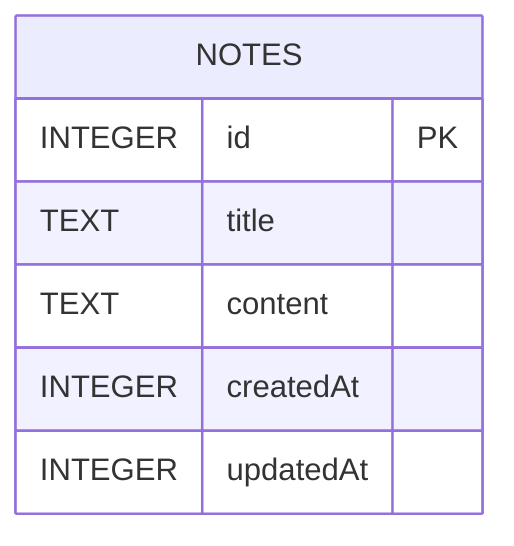
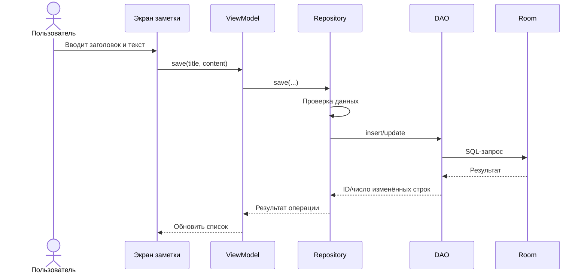

# Интеграция слоя данных — «Заметки»

## Компонентная схема

## Схема БД

## Контракт
| Компонент | Метод | Назначение |
|---|---|---|
| Note | id, title, content, createdAt, updatedAt | Модель заметки |
| NoteDao | getAll() | Все заметки по дате изменения |
| NoteDao | search(query) | Поиск в заголовке и тексте |
| NoteDao | getById(id) | Получить одну заметку |
| NoteDao | insert/update/delete | CRUD-запросы |
| NoteRepository | observeAll() | Поток всех заметок |
| NoteRepository | search(query) | Поиск, пустой запрос возвращает всё |
| NoteRepository | save(title, content, id?) | Создать или изменить заметку |
| NoteRepository | delete(id) | Удалить заметку |
| NoteRepository | exportText(notes) | Подготовить содержимое TXT |

## Правила
1. Заголовок и текст не могут быть одновременно пустыми.
2. При создании обе даты устанавливаются текущим временем.
3. При редактировании обновляется `updatedAt`, `createdAt` не меняется.
4. Поиск выполняется по заголовку и содержимому без учёта регистра.
5. Ошибка удаления отсутствующей записи обрабатывается без аварийного завершения.
6. Экспорт не изменяет БД; текст записывается в UTF-8.

## Последовательность сохранения

## Экспорт
Для экспорта приложение запускает `ACTION_CREATE_DOCUMENT` с MIME `text/plain`. После выбора места Android возвращает `Uri`; содержимое формируется в UTF-8 и записывается через `ContentResolver`. Отмена диалога не меняет заметки.
