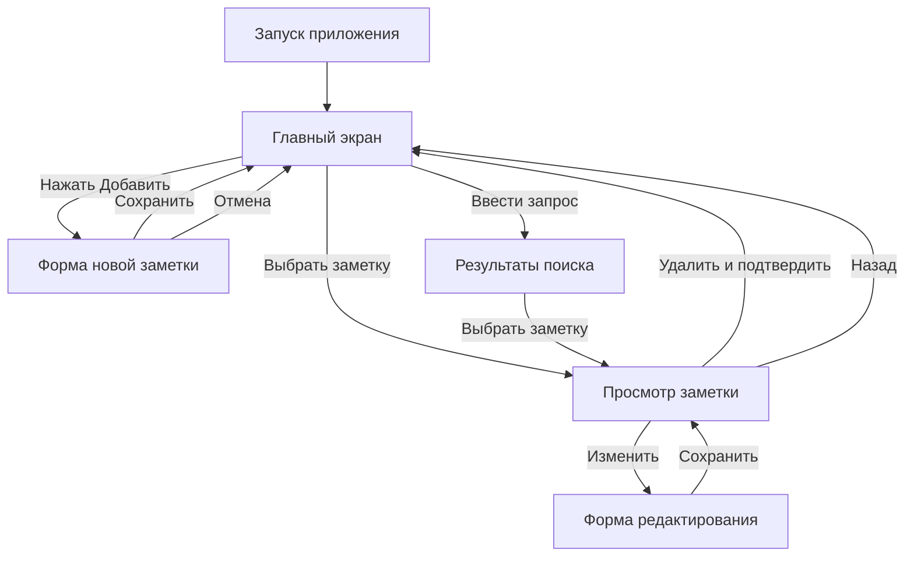

# Описание пользовательского интерфейса (день 6)

**Проект:** мобильное приложение «Заметки»  
**Язык:** Kotlin  
**Среда:** Android Studio  
**Разметка:** XML  
**Компоненты:** RecyclerView, EditText, Button, AlertDialog, Room.

## Состав экранов
| № | Экран | Назначение | Основные элементы |
|---|---|---|---|
| 1 | Главный экран | просмотр всех заметок | заголовок, поиск, RecyclerView, кнопка добавления |
| 2 | Форма заметки | создание и редактирование | поле названия, поле текста, «Сохранить», «Отмена» |
| 3 | Просмотр заметки | чтение выбранной заметки | название, текст, «Изменить», «Удалить» |
| 4 | Пустое состояние | объяснение отсутствия данных | текст-подсказка и кнопка добавления |
| 5 | Нет результатов | сообщение о пустом результате поиска | текст «По запросу ничего не найдено» |

## Навигация

## Описание состояний
| Состояние | Условие | Отображение |
|---|---|---|
| Пустой список | в базе нет заметок | «Заметок пока нет. Нажмите „Добавить“, чтобы создать первую.» |
| Результаты поиска | совпадения найдены | список подходящих заметок |
| Нет результатов | совпадений нет | «По запросу ничего не найдено.» |
| Ошибка валидации | пустое название или текст | Toast с пояснением, запись не сохраняется |
| Подтверждение удаления | пользователь нажал «Удалить» | диалог с кнопками «Отмена» и «Удалить» |

## Связь интерфейса с логикой и данными
Главный экран получает данные через `NoteRepository`. Репозиторий обращается
к `NoteDao`, который выполняет запросы к локальной базе Room. `NoteAdapter`
отображает полученный список в RecyclerView. Форма передаёт значения в метод
`save()`, где выполняется проверка обязательных полей. Экран просмотра получает
идентификатор заметки и загружает её из базы данных.

## Структура основных файлов
- `ui/MainActivity.kt` — главный экран, поиск и список;
- `ui/NoteAdapter.kt` — адаптер RecyclerView;
- `ui/EditNoteActivity.kt` — создание и изменение;
- `ui/NoteDetailsActivity.kt` — просмотр и удаление;
- `data/Note.kt` — сущность Room;
- `data/NoteDao.kt` — запросы к базе;
- `data/NotesDatabase.kt` — экземпляр базы данных;
- `data/NoteRepository.kt` — бизнес-логика и валидация;
- `res/layout/` — XML-макеты экранов.
