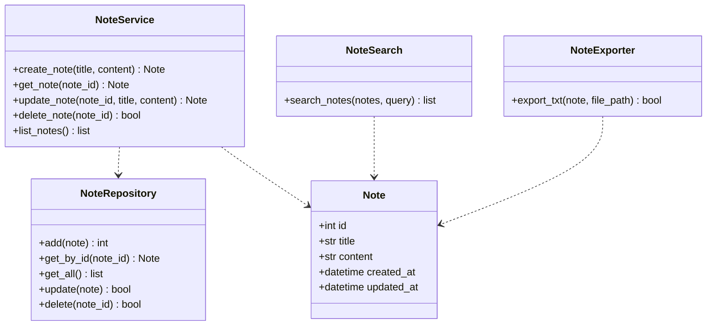

# Архитектура мобильного приложения «Заметки» (день 3)

## 1. Назначение

Приложение предназначено для создания, просмотра, редактирования, удаления и поиска личных заметок. Данные сохраняются локально на устройстве. Пользователь может экспортировать заметку в файл.

## 2. Слои архитектуры

| Слой | Модуль | Ответственность |
|---|---|---|
| Интерфейс (UI) | `src/ui` | Экраны списка и редактора заметки, элементы управления, отображение результатов поиска |
| Ядро | `src/core` | Проверка данных, операции над заметками, поиск, подготовка данных к экспорту |
| Данные | `src/data` | Локальное хранилище, чтение и запись заметок, обновление и удаление |

Зависимости направлены вниз: UI → ядро → данные. Ядро не должно зависеть от конкретных экранов. Доступ к хранилищу выполняется через отдельный интерфейс репозитория, чтобы при необходимости можно было заменить способ хранения без изменения бизнес-логики.

## 3. Сущность Note

| Поле | Тип | Назначение |
|---|---|---|
| `id` | integer/string | Уникальный идентификатор заметки |
| `title` | string | Заголовок заметки |
| `content` | string | Основной текст |
| `created_at` | datetime/string | Дата и время создания |
| `updated_at` | datetime/string | Дата и время последнего изменения |

Заголовок может быть пустым при условии, что содержимое заметки не пустое. Для отображения заметки без заголовка интерфейс может использовать подпись «Без названия». Время создания не меняется при редактировании, `updated_at` обновляется.

## 4. Диаграмма классов

## 5. Контракт интерфейсов

| Модуль | Элемент | Поведение |
|---|---|---|
| `models` | `Note(id=None, title="", content="", created_at=None, updated_at=None)` | Модель заметки |
| `service` | `create_note(title, content) -> Note` | Создаёт заметку; запрещает сохранение полностью пустой заметки |
| `service` | `get_note(note_id) -> Note \| None` | Возвращает заметку по идентификатору |
| `service` | `update_note(note_id, title, content) -> Note` | Обновляет заголовок и текст, меняет `updated_at` |
| `service` | `delete_note(note_id) -> bool` | Удаляет заметку; возвращает результат операции |
| `service` | `list_notes() -> list[Note]` | Возвращает все заметки, новые или недавно изменённые — первыми |
| `search` | `search_notes(notes, query) -> list[Note]` | Ищет подстроку в заголовке и содержимом без учёта регистра; пустой запрос возвращает исходный список |
| `exporter` | `export_txt(note, file_path) -> bool` | Записывает заголовок, даты и содержимое заметки в UTF-8 текстовый файл; ошибки ввода-вывода обрабатываются |

## 6. Локальное хранение

Для практической работы используется локальная база SQLite (либо другой согласованный преподавателем локальный механизм). Минимальная таблица `notes` содержит поля `id`, `title`, `content`, `created_at`, `updated_at`. Сетевые запросы и облачная синхронизация не требуются. Изменения должны сохраняться после закрытия и повторного запуска приложения.

## 7. Экспорт

Пользователь выбирает команду «Экспортировать», после чего приложение предлагает сохранить выбранную заметку в файл `.txt`. Кодировка файла — UTF-8. Если файл создать не удалось, приложение показывает понятное сообщение и не удаляет исходную заметку.

## 8. Соответствие требованиям

| Требование | Реализация |
|---|---|
| Создание заметки | `NoteService.create_note` |
| Просмотр списка и отдельной заметки | `list_notes`, `get_note` |
| Редактирование | `NoteService.update_note` |
| Удаление | `NoteService.delete_note` |
| Локальное хранение | `NoteRepository` |
| Поиск | `NoteSearch.search_notes` |
| Экспорт | `NoteExporter.export_txt` |
