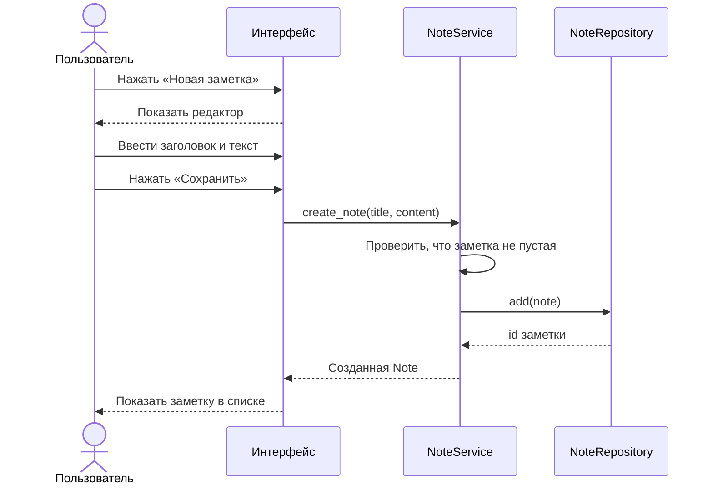
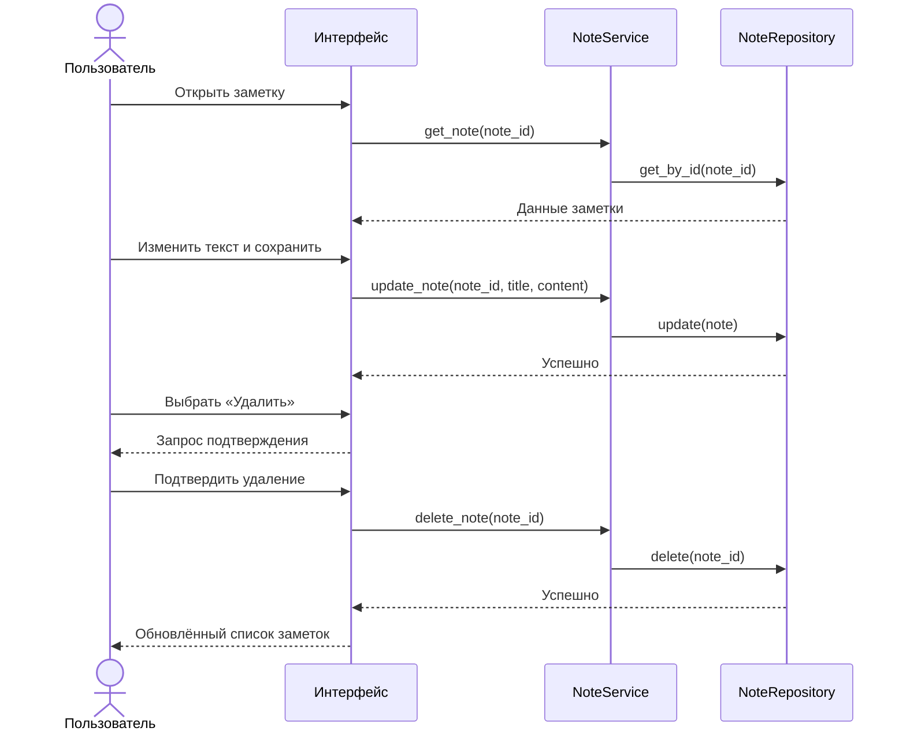
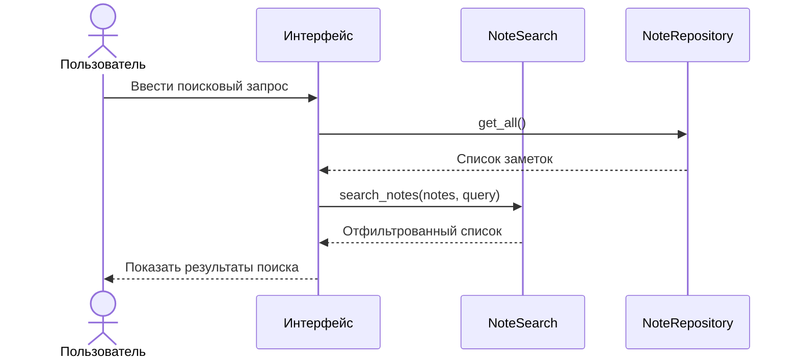
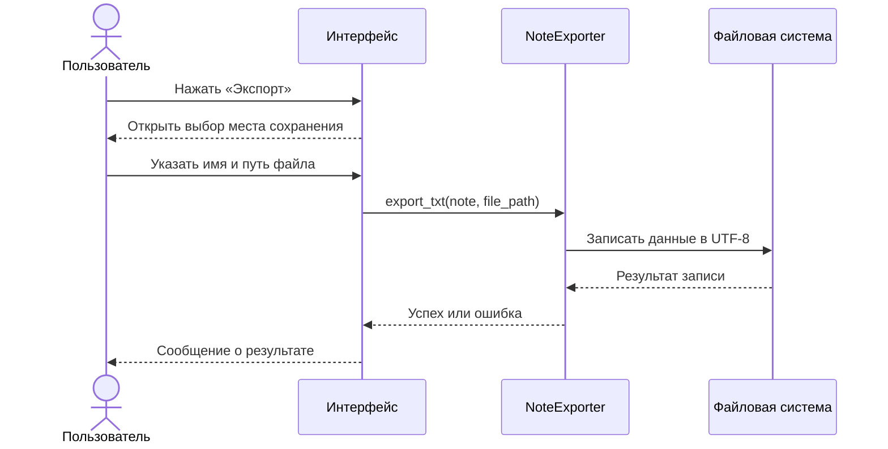

# Диаграммы последовательности (день 3)

## Сценарий 1. Создание и сохранение заметки

## Сценарий 2. Редактирование и удаление заметки

## Сценарий 3. Поиск заметок

## Сценарий 4. Экспорт заметки в файл

